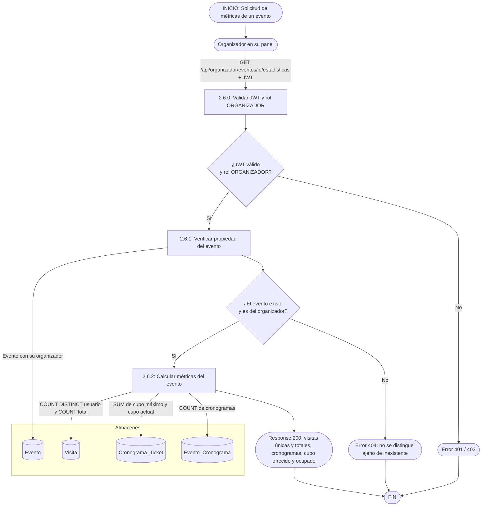

# DFD — Consulta de estadísticas de un evento (estado actual del código)

> **Qué describe:** lo que **existe hoy** (`GET /api/organizador/eventos/{id}/estadisticas`, `EventoService.estadisticas`). Las métricas son **del evento completo**. Lo que falta —estadísticas **por cronograma** y las avanzadas del plan Pro— está especificado en [tempDFD](../../tempDFD/README.md): [2.10](../../tempDFD/modulo_2_estadisticas/2.10_estadisticas_por_cronograma.md) y [8.3](../../tempDFD/modulo_8_membresias/8.3_restriccion_features_pro.md).
>
> Reescrito el 2026-10-19: la versión anterior mostraba una bifurcación por plan Pro que nunca se programó.

## Notas

- **No hay valoraciones en esta respuesta.** El promedio por función es justamente lo que agrega 2.10.
- **No hay bifurcación por plan:** hoy cualquier organizador ve estas métricas. La restricción Pro aplicará solo a las **avanzadas** (8.3).
- **Evento ajeno = 404**, no 403, para no revelar qué ids existen.
