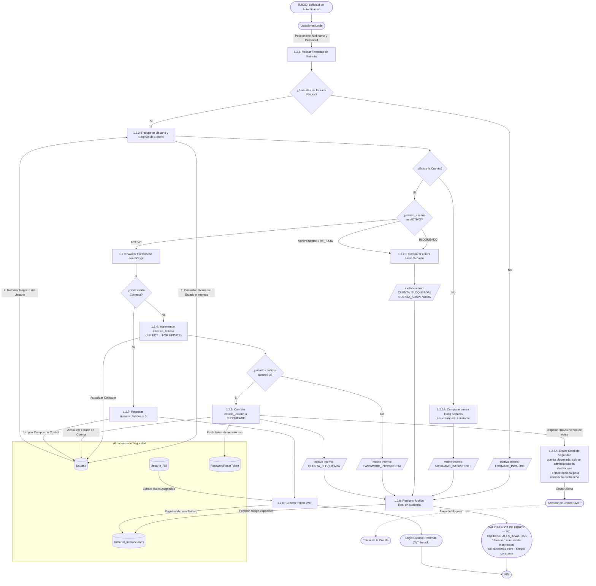
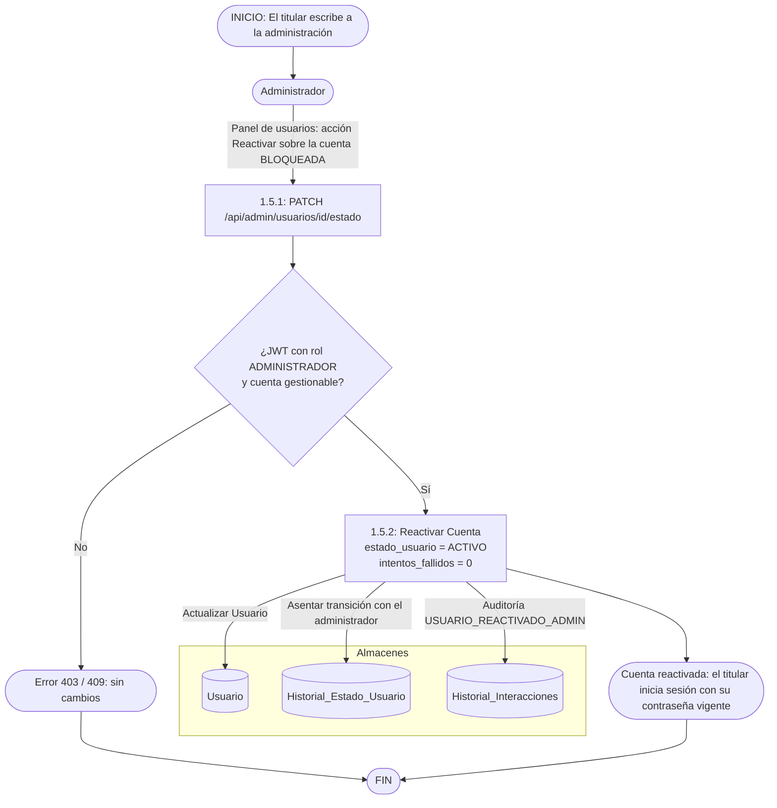

# DFD 1.2 — Inicio de Sesión

> **Revisado 2026-09-30.** El identificador de login pasó de **email** a **nickname**: el email
> queda como dato de contacto de la cuenta (recuperación de acceso, aviso de bloqueo por
> RF-1.5) pero dejó de ser lo que el usuario escribe para entrar. El motivo interno
> `EMAIL_INEXISTENTE` se renombró a `NICKNAME_INEXISTENTE` y el mensaje público pasó de
> "Email o contraseña incorrectos" a "Usuario o contraseña incorrectos" (ver
> `UsuarioLoginRequest`, `AuthService.login`).

> **Revisado 2026-09-09.** Reemplaza la versión anterior, que describía control de tráfico por IP,
> una escalera de penalización 3/6/9, verificación CAPTCHA y un segundo factor por correo (2FA).
> Ninguno de esos cuatro mecanismos forma parte del alcance vigente:
>
> | Mecanismo anterior | Estado | Motivo |
> |---|---|---|
> | Rate limiting por IP (`1.2.1`) | ❌ eliminado | Detrás de CGNAT bloquea a cientos de usuarios legítimos por un solo atacante (RF-1.4) |
> | Escalera 3 → 6 → 9 fallos | ❌ reemplazada | Decisión final: **bloqueo directo al 3° fallo** (RF-1.4) |
> | CAPTCHA (`1.2.4A`) | ⏸️ diferido | Fuera del alcance actual |
> | 2FA por correo (`1.2.8`/`1.2.9`) | ⏸️ diferido | Fuera del alcance actual |
> | `Err_Block` ("Cuenta Bloqueada por Seguridad") | ❌ eliminado | Revelaba el estado de la cuenta al atacante; ahora el rechazo es **indistinguible** |

## Principio rector: **una sola salida de error**

Todas las rutas de rechazo convergen en `Err_Generico`. Desde fuera son idénticas en
código HTTP (401), código de aplicación (`CREDENCIALES_INVALIDAS`), mensaje, cabeceras y
**tiempo de respuesta**. El motivo real se bifurca únicamente hacia el log y la auditoría.

## DFD 1.5 — Desbloqueo de cuenta: exclusivo del panel de administración

> **Decisión del 2026-10-19: nadie más puede desbloquear una cuenta.** Se descartó el enlace `/unlock-account?token=` del correo. El titular puede cambiar su contraseña con el enlace de restablecimiento (RF-1.5), pero la cuenta sigue `BLOQUEADA` hasta que un administrador la reactive. El detalle de la reactivación está en el [DFD 6.2](../modulo_6_admin/6.2_gestion_cuentas_usuario.md).

