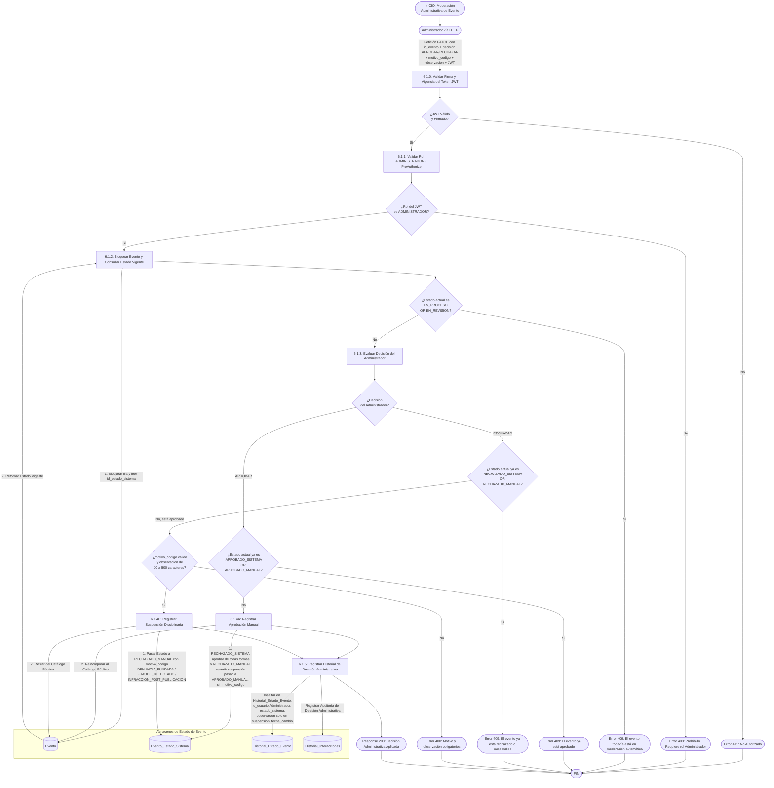
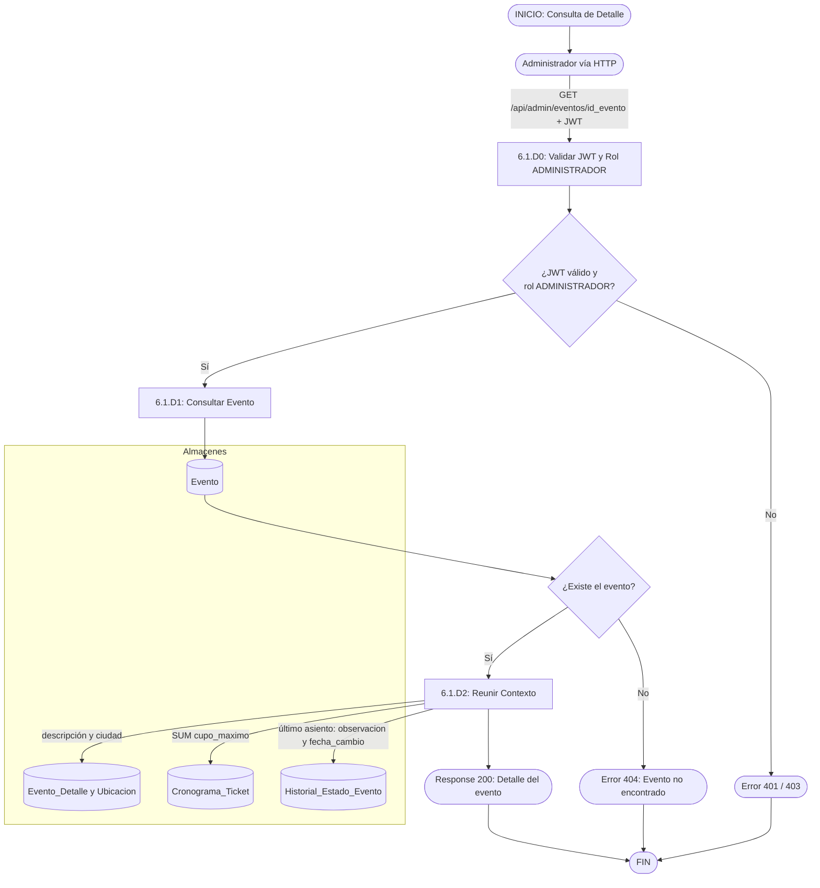

### 6.1.D — Consulta de detalle de un evento (lectura)

El administrador abre el detalle de cualquier evento, sea cual sea su estado, para decidir con información. A diferencia de la ficha pública (RF-4.4), **no registra una visita** y no exige que el evento sea visible en el catálogo.

