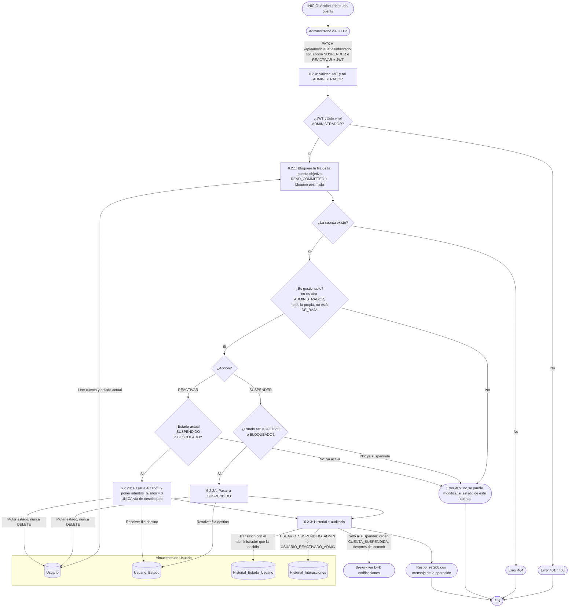

# DFD 6.2 — Gestión de cuentas de usuario (RF-6.2)

Alineado con el código (`AdminUsuarioService`, `UsuarioAdminController`) el 2026-10-19. Acciones: **SUSPENDER** y **REACTIVAR**. *Reactivar* es también la **única vía de desbloqueo** de una cuenta bloqueada por intentos fallidos.

## Reglas

| Regla | Motivo |
|---|---|
| **Reactivar es la única vía de desbloqueo.** El enlace de recuperación por correo solo cambia la contraseña. | Una sola puerta, auditada (ADR del 2026-10-19). |
| **`intentos_fallidos = 0` al reactivar.** | Si no, la cuenta volvería a bloquearse al primer error de tipeo. |
| **Cuentas protegidas:** otro `ADMINISTRADOR`, la propia y las `DE_BAJA`. | Una suspensión por error del único administrador dejaría el panel inaccesible; la baja es decisión del titular. El campo `gestionable` de cada fila es la fuente única de verdad. |
| **El administrador pide una acción, no un estado destino.** | El servicio resuelve origen y destino con lo que hay en la base y valida la transición (ADR-23). |
| **Bloqueo pesimista de la fila + `READ_COMMITTED`.** | La cuenta puede estar siendo tocada a la vez por el login (contador de intentos) o por otro administrador. |
| **El aviso por correo es solo de la suspensión.** Reactivar no envía correo. | El catálogo de notificaciones solo cubre `CUENTA_SUSPENDIDA`. Ver *Sugerencias* abajo. |

> **Sugerencia pendiente:** avisar por correo al titular cuando su cuenta se reactiva (nuevo tipo `CUENTA_REACTIVADA`), ya que hoy se entera solo al volver a iniciar sesión. Ver [SUGERENCIAS_PENDIENTES.md](../../SUGERENCIAS_PENDIENTES.md).
