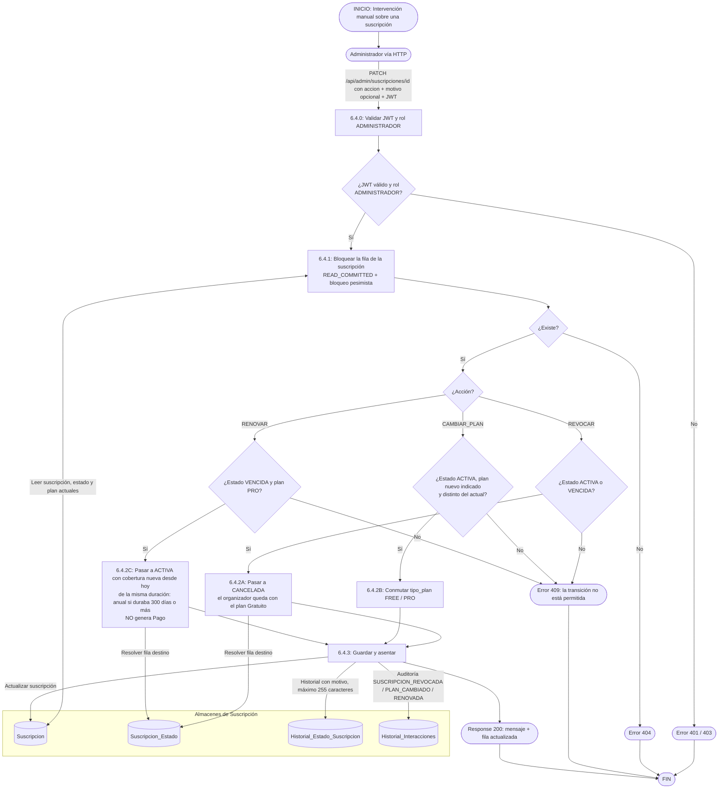

# DFD 6.4 — Auditoría e intervención excepcional de suscripciones (RF-6.4)

Alineado con el código (`AdminSuscripcionService`, `SuscripcionAdminController`) el 2026-10-19. El administrador pide una **acción**, no un estado destino (ADR-23): el servicio resuelve origen y destino con lo que hay en la base. Las tres acciones son **REVOCAR**, **CAMBIAR_PLAN** y **RENOVAR**.

## Reglas

| Regla | Motivo |
|---|---|
| **El plan vigente es el de la última suscripción; sin suscripciones, es Gratuito** (ADR-26). | No se siembra una fila "FREE" por cada cuenta. |
| **Renovar omite la pasarela a propósito** y no genera `Pago`. | Es una excepción administrativa; no cuenta como ingreso. |
| **Revocar deja al organizador con el plan Gratuito pero con todos sus eventos.** | Desde el 2026-10-19 ningún plan limita los eventos (D2). |
| **Toda intervención deja historial con motivo y auditoría.** Si no se manda motivo se usa uno por defecto. | Trazabilidad ante disputas comerciales. |
| **Los contadores del panel cuentan solo cuentas `ACTIVAS`.** | Un organizador bloqueado, suspendido o dado de baja no es "usuario activo del plan". |
