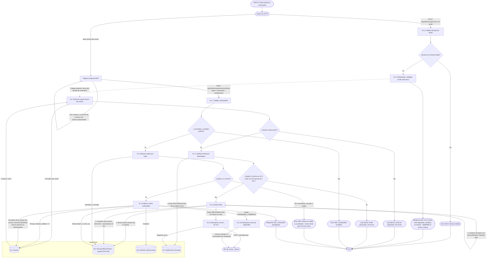

# DFD Nivel 2 — N.1 Recuperación de contraseña por correo (RF-1.5)

Descompone el proceso **N.1** del [Nivel 1](./nivel1_notificaciones.md) para el caso de la recuperación pedida por el propio usuario. El bloqueo por intentos (RF-1.4) comparte la emisión y el consumo del token.

**Principio rector:** el endpoint público no puede revelar si un correo está registrado. La respuesta, su contenido **y su tiempo** deben ser idénticos exista o no la cuenta.

## Por qué cada decisión

| Decisión | Amenaza que cierra |
|---|---|
| **N.1.2 responde antes de buscar la cuenta** y el resto corre asíncrono | *Oráculo de tiempo*: con cuenta se hacen escrituras (borrar y guardar token); sin cuenta no. Si eso ocurriera dentro de la petición, la diferencia de milisegundos enumeraría cuentas. |
| **Mismo cuerpo `202`** exista o no el correo | *Enumeración de cuentas* por contenido de respuesta. |
| **N.1.4 límite por destinatario, no por IP** | *Email bombing* a una casilla ajena y agotamiento de la cuota diaria del proveedor. Un límite por IP reintroduciría el problema de CGNAT por el que se eliminó el rate limiting por IP. |
| **Token de 256 bits, solo el hash en base** | Un dump de la tabla no entrega enlaces utilizables. |
| **Un token vigente por cuenta** | Enlaces viejos reenviados o filtrados dejan de servir apenas se pide uno nuevo. |
| **Token fuera de la barra de direcciones** (`replaceState`) y `Referrer-Policy: no-referrer` | Filtración por historial del navegador o cabecera `Referer`. |
| **Mismo error** para token inexistente, vencido o usado | No ayudar a distinguir un token inventado de uno caducado. |
| **No tocar el estado de la cuenta** (desde el 2026-10-19) | Una sola puerta para desbloquear (el panel de administración, auditada) y que ninguna sanción (`SUSPENDIDA`) ni bloqueo se levante pidiendo un reset. |
| **N.1.10 aviso "contraseña cambiada"** | Si alguien tomó la cuenta, el titular legítimo se entera por el único canal que el atacante no controla. |
| **URL base desde configuración**, no del header `Host` | *Host header poisoning*: un enlace de recuperación apuntando a un dominio del atacante. |

> **Limitación conocida (fuera de este DFD):** los JWT ya emitidos siguen siendo válidos hasta su vencimiento aunque cambie la contraseña. La revocación se trata en la etapa de seguridad.
