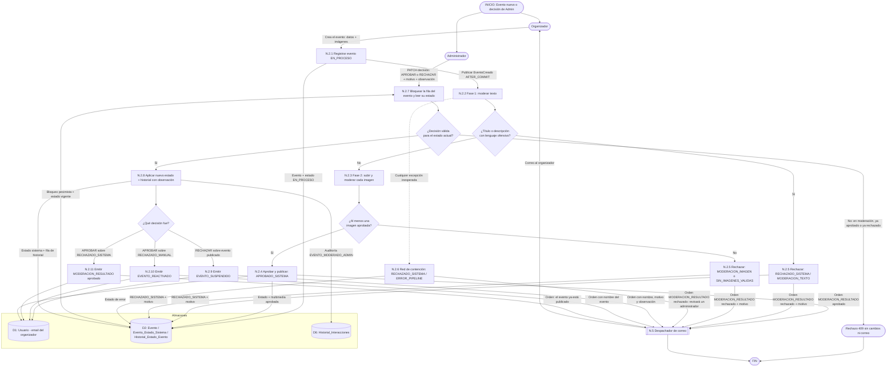

# DFD Nivel 2 — N.2 Notificaciones por moderación de eventos

Descompone el proceso **N.2** del [Nivel 1](./nivel1_notificaciones.md): los correos al organizador cuando cambia el veredicto sobre su evento. Hay dos orígenes: el **pipeline automático** (RF-2.2, RF-5.1 a 5.3) y la **decisión de un administrador** (RF-6.1).

## Reglas

| Regla | Motivo |
|---|---|
| **El correo sale después del commit y nunca propaga fallos.** Lo garantiza el despachador (N.5), no cada origen. | Un correo no puede salir por una transacción revertida, ni un proveedor caído puede tirar abajo una decisión de moderación. |
| **Matriz de decisión del Admin:** APROBAR solo sobre `RECHAZADO_SISTEMA` o `RECHAZADO_MANUAL`; RECHAZAR solo sobre un evento publicado (`APROBADO_*`). | Sobre un evento en `EN_PROCESO` / `EN_REVISION` no hay veredicto firme que cambiar; aprobar uno ya aprobado o rechazar uno ya rechazado no cambia nada, así que tampoco se avisa. |
| **Aprobar un rechazo del sistema NO es una reactivación.** Se avisa con `MODERACION_RESULTADO` ("ya está publicado"). Solo se usa `EVENTO_REACTIVADO` al revertir una **suspensión** (`RECHAZADO_MANUAL`). | Un evento rechazado por el pipeline nunca estuvo al aire; decirle al organizador que "volvió" sería falso. |
| **Suspender exige motivo (`MotivoSuspensionAdmin`) y observación;** aprobar descarta la observación aunque el cliente la mande. | El organizador necesita saber qué corregir o apelar, y el historial no debe cargar texto que nadie pidió. |
| **Bloqueo de fila + `READ_COMMITTED`** en la decisión del Admin. | El pipeline o el propio organizador (editar, dar de baja) pueden tocar el mismo evento en paralelo. |
| **Sin libro de idempotencia (D7) en este grupo.** Son avisos de una acción puntual de una persona o del pipeline, que corre una sola vez por evento. | A diferencia del recordatorio, no hay un reloj que repita el disparo. Ver N.5: `despachar` frente a `despacharUnico`. |
| **El correo se arma con el nombre del evento ya escapado** por `CorreoHtml`; la observación del Admin es texto libre y nunca se vuelve enlace. | Único punto donde se escapa HTML (N.5). |
| **La edición de un evento ya aprobado (RF-2.7) NO genera correo.** Se modera de forma sincrónica y si falla, responde con error al organizador en la misma petición. | El organizador ve el resultado en pantalla; un correo duplicaría la respuesta HTTP. |

> **Cobertura de estados:** `ERROR_PIPELINE` es el único rechazo que el organizador no causó. El correo lo dice ("un administrador va a revisarlo") y deja el evento en una cola revisable en el panel de moderación en lugar de colgado en `EN_PROCESO`.
