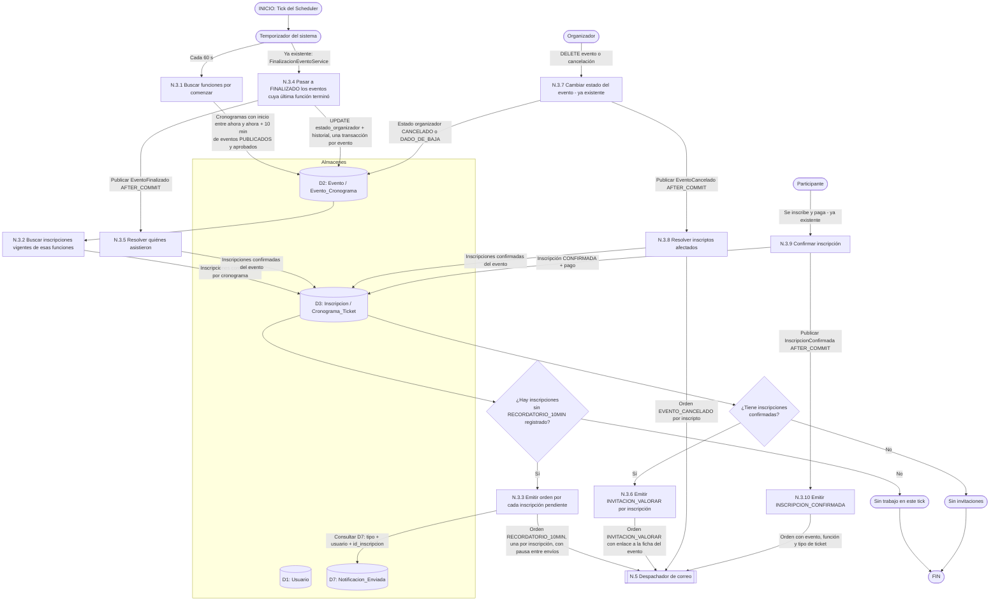

# DFD Nivel 2 — N.3 Notificaciones a inscriptos disparadas por el sistema

Descompone el proceso **N.3** del [Nivel 1](./nivel1_notificaciones.md) para los correos que **no los dispara una persona sino el reloj**: el recordatorio de 10 minutos y la invitación a valorar (RF-3.4). Reutiliza el Scheduler que ya existe para `FINALIZADO`.

## Reglas

| Regla | Motivo |
|---|---|
| **Ventana de 10 minutos, no instante exacto.** Se busca `inicio ∈ (ahora, ahora + 10 min]` y se excluye lo ya enviado. | Si el Scheduler pierde un tick (reinicio, carga), el recordatorio igual sale en el siguiente. Una comparación de igualdad exacta lo perdería para siempre. |
| **Idempotencia en D7** por `(tipo, id_usuario, id_inscripcion)`. | Con ticks cada minuto, una inscripción caería en la ventana ~10 veces. Sin la restricción única recibiría 10 correos. |
| **Una función, no un evento.** El recordatorio es por `Evento_Cronograma`. | Un evento con varias fechas debe avisar antes de cada una, no solo de la primera. |
| **Solo inscripciones confirmadas** de eventos `PUBLICADO` + `APROBADO_*`. | No avisar de un evento suspendido, cancelado o rechazado, ni a quien canceló su inscripción. |
| **Si el evento se cancela dentro de la ventana,** el recordatorio ya no sale. | La consulta de N.3.1 filtra por estado vigente en el momento de cada tick. |
| **Eventos publicados con `AFTER_COMMIT`** (N.3.5, N.3.8, N.3.10). | Mismo criterio de CLAUDE.md para el pipeline asíncrono: el hilo que envía debe ver la fila ya confirmada. |
| **Los administradores no reciben estos correos como participantes.** | Un administrador es solo admin y no puede inscribirse (regla de roles de 2026-10-15). |
| **Envío masivo con pausa** entre correos. | Cuidar la cuota diaria del proveedor y evitar ráfagas. |

> **Probar sin esperar:** el adelanto es configurable en segundos (`enexia.notificaciones.recordatorio.segundos-antes`, 600 por defecto). Para una prueba manual alcanza con `30` y `intervalo-ms=5000`; el intervalo debe ser menor que el adelanto o una funcion puede empezar entre dos pasadas sin avisarse.

> **Zona horaria:** el cálculo de la ventana usa la hora del servidor con la zona `America/Argentina/Ushuaia`, la misma que declara la conexión a la base. Un desfase aquí adelantaría o atrasaría todos los recordatorios.
