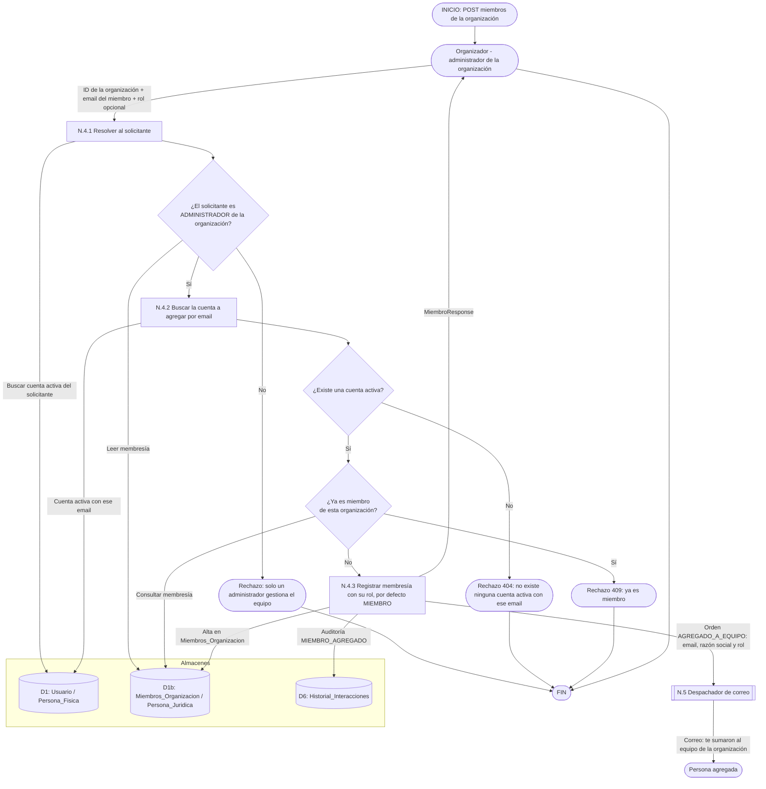

# DFD Nivel 2 — N.4 Notificación por alta en el equipo de una organización

Descompone el proceso **N.4** del [Nivel 1](./nivel1_notificaciones.md): el aviso `AGREGADO_A_EQUIPO` cuando un administrador de una organización suma a otra persona desde "Mi Equipo" (RF-7.2). Quitar a un miembro **no** genera correo.

## Reglas

| Regla | Motivo |
|---|---|
| **Solo un `ADMINISTRADOR` de la organización agrega miembros.** Cualquier miembro puede listar el equipo. | Es la misma regla que gobierna quitar miembros; el aviso sale únicamente de la acción autorizada. |
| **Solo se puede agregar una cuenta activa existente.** No hay invitaciones a emails sin cuenta. | El correo se manda a una persona ya registrada, y no existe un flujo de invitación pendiente que consumir. |
| **El destinatario del aviso es la persona agregada,** no el administrador. El administrador ya conoce la acción: la ve en pantalla. | Es la contraparte que podría no esperar el alta. |
| **El correo ofrece una salida:** si no esperaba la invitación, que contacte a la administración. | Quien agrega miembros escribe el email a mano; un error de tipeo no debería sumar a un tercero sin que se entere. |
| **Sin libro de idempotencia (D7).** Es un aviso por acción puntual de una persona (`despachar`). | La restricción de membresía única ya impide el segundo alta; la repetición no puede ocurrir. |
| **Sale después del commit.** Un alta que se revierte por conflicto de concurrencia no envía el aviso. | Regla general del despachador N.5. |
| **Quitar a un miembro no avisa.** Y nunca se puede quitar al último administrador. | Decisión de alcance: el catálogo de notificaciones solo cubre el alta. Si más adelante se agrega, se suma un tipo nuevo al enum, sin renombrar los existentes. |
