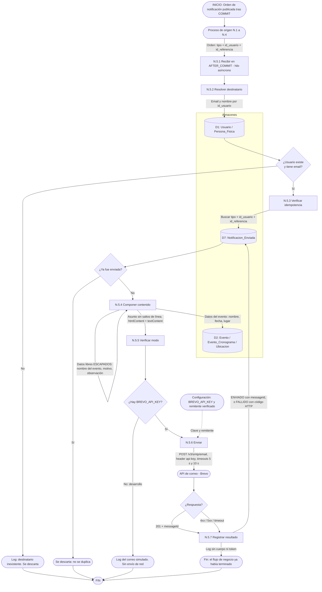

# DFD Nivel 2 — N.5 Despachador de correo

Descompone el proceso **N.5** del [Nivel 1](./nivel1_notificaciones.md). Es el **único punto del sistema que habla con el proveedor de correo**, de modo que el escapado de HTML, la idempotencia y el manejo de fallos viven en un solo lugar.

## Reglas del despachador

1. **Después del commit, nunca antes.** Un correo no puede salir por una transacción que se revierte, ni referirse a una fila que el hilo aún no ve.
2. **Asíncrono siempre.** Si el envío fuera síncrono, el intento de login que dispara el bloqueo tardaría más que los anteriores y esa diferencia de tiempo delataría que la cuenta existe.
3. **Un fallo de envío jamás propaga.** Se registra `FALLIDO` en D7 y el flujo que lo originó ya terminó.
4. **Escapado en un solo lugar.** El nombre de evento, el motivo y la observación del admin los escribe un usuario; si llegan sin escapar a `htmlContent` son una inyección de HTML por correo. El asunto se sanea de saltos de línea.
5. **Idempotencia por `(tipo, id_usuario, id_referencia)`.** El Scheduler puede reintentar sin duplicar correos.
6. **Los logs no contienen el cuerpo.** Algunos correos llevan un token de recuperación, que en un log es una credencial en claro.
7. **Sin `BREVO_API_KEY` el sistema arranca igual**, en modo simulado que vuelca el correo al log. Es lo que permite desarrollar y probar sin cuenta del proveedor.

## Límite del plan gratuito

El plan gratuito del proveedor tiene un tope diario (del orden de 300 correos, a confirmar en su panel). Un evento con muchos inscriptos que se cancela, o una invitación a valorar masiva, pueden agotarlo. Por eso los envíos masivos se hacen **de a uno con una pausa corta** y los fallidos quedan en `FALLIDO` para poder reintentarlos al día siguiente.
