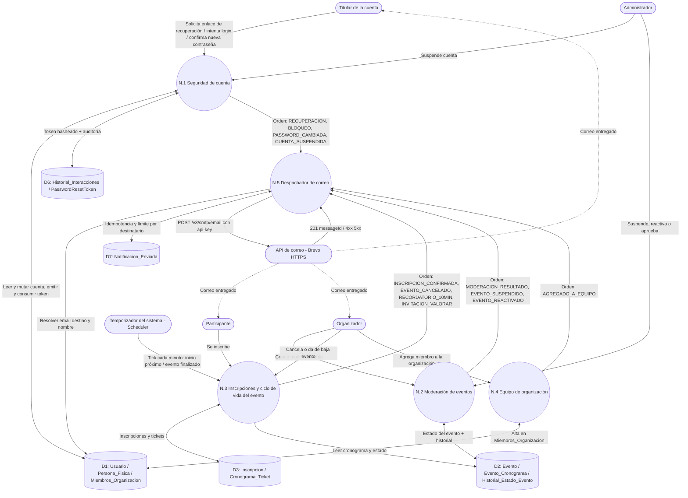

# DFD Nivel 1 — Notificaciones por correo

Subsistema transversal: no tiene pantalla propia. Cada módulo **emite una orden de notificación** y un único despachador (N.5) compone, protege y envía el correo a través de la API HTTPS del proveedor (Brevo).

> **Prefijo `N`:** el "Módulo 7" de la documentación funcional es *Organizaciones*; para no pisar su numeración, este subsistema usa `N.x`.

## Catálogo de notificaciones

| Código | Destinatario | Origen | Estado |
|---|---|---|---|
| `RECUPERACION` | Titular | N.1, a pedido del usuario | Existe (se endurece) |
| `BLOQUEO` | Titular | N.1, 3er intento fallido | Existe |
| `PASSWORD_CAMBIADA` | Titular | N.1, al consumir el token | **Nuevo** |
| `CUENTA_SUSPENDIDA` | Titular | N.1, acción de Admin (RF-6.2) | **Nuevo** |
| `MODERACION_RESULTADO` | Organizador | N.2, pipeline automático | Existe |
| `EVENTO_SUSPENDIDO` | Organizador | N.2, Admin (motivo + observación) | **Nuevo** |
| `EVENTO_REACTIVADO` | Organizador | N.2, Admin revierte | **Nuevo** |
| `INSCRIPCION_CONFIRMADA` | Participante | N.3, al confirmarse la inscripción | **Nuevo** |
| `EVENTO_CANCELADO` | Participantes inscriptos | N.3, cancelación / baja del evento | **Nuevo** |
| `RECORDATORIO_10MIN` | Participantes inscriptos | N.3, Scheduler | **Nuevo** |
| `INVITACION_VALORAR` | Participantes inscriptos | N.3, evento pasa a `FINALIZADO` (RF-3.4) | **Nuevo** |
| `AGREGADO_A_EQUIPO` | Miembro agregado | N.4, "Mi Equipo" | **Nuevo** |

## Flujos de datos

- **Órdenes de notificación** (N.1–N.4 → N.5): contienen solo `tipo`, `id_usuario` destino y un `id_referencia` (evento, inscripción, organización). **Nunca llevan el cuerpo del correo ni datos libres ya renderizados:** el despachador los compone, así existe un único punto donde se escapa el HTML.
- **D7 Notificacion_Enviada:** guarda `(tipo, id_usuario, id_referencia, fecha, estado)`. Cumple dos funciones: evitar duplicados (un recordatorio por inscripción, una invitación por inscripción) y contar envíos recientes para el límite por destinatario.
- **Disparo post-commit:** N.1–N.4 publican un evento de aplicación y el despachador reacciona en `AFTER_COMMIT`. Un correo nunca sale por una transacción que luego se revierte (ver CLAUDE.md, "Async pipeline").
- **Fallo del proveedor:** se registra en D7 como `FALLIDO` y el flujo de negocio que lo originó **no se entera**.
