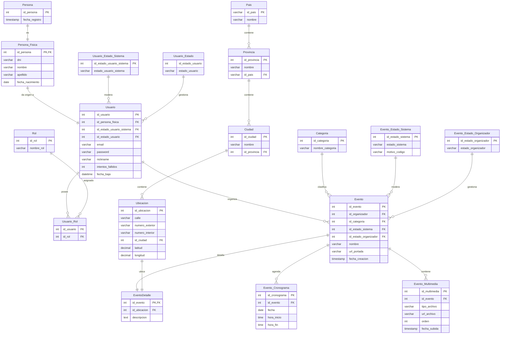

# MER reducido: registro, login y crear evento

Subconjunto minimo de [MER.md](./MER.md): solo las tablas sin las cuales no se pueden ejecutar estos flujos.

- `POST /api/auth/registro` (Persona Fisica)
- `POST /api/auth/login`
- `POST /api/organizador/eventos` (evento a titulo personal)

Las columnas son copia literal del MER completo.

## Por que cada tabla

| Flujo | Tablas |
|---|---|
| Registro y login | `Persona`, `Persona_Fisica`, `Usuario`, `Usuario_Estado_Sistema`, `Usuario_Estado` (el estado ACTIVO/BLOQUEADO se consulta en el login), `Rol`, `Usuario_Rol` (los roles viajan en el JWT) |
| Crear evento | `Evento`, `EventoDetalle`, `Evento_Cronograma`, `Evento_Multimedia`, `Categoria`, `Evento_Estado_Sistema`, `Evento_Estado_Organizador`, `Ubicacion`, `Ciudad`, `Provincia`, `Pais` |

## Recortes respecto de la version anterior

- **Organizaciones:** se quitaron `Persona_Juridica`, `Miembros_Organizacion`, sus catalogos e historial, y la columna `Evento.id_persona_juridica` (era nullable). Con esto el evento solo puede ser a titulo personal, y el registro es solo `POST /api/auth/registro`, sin `registro/organizacion`.
- **Historiales:** se quitaron `Historial_Estado_Usuario`, `Historial_Estado_Evento` e `Historial_Interacciones`. Son auditoria, no condicion para que los flujos funcionen. El codigo actual probablemente los escribe, asi que si se implementa contra este modelo habra que desactivar ese paso.
- **Tickets:** se quitaron `Cronograma_Ticket` y `Tipo_Ticket`. El evento queda con fecha y horario, pero sin cupos ni precios.
- **Geografia:** `Ciudad`, `Provincia` y `Pais` se mantienen aunque parezcan accesorias, porque `Ubicacion.id_ciudad` es FK y la cadena llega hasta `Pais`.
