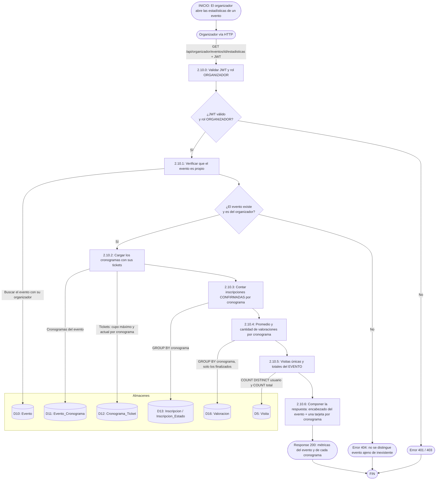

# DFD 2.10 — Estadísticas básicas por cronograma (RF-2.10)

**Estado:** pendiente de programar. Reemplaza, para lo que viene, al DFD [consultar_estadisticas.md](../../diagrams/gestion_de_eventos/consultar_estadisticas.md), que describe lo que existe hoy (métricas **del evento completo**).

## Por qué por cronograma

Un evento tiene varias funciones (`Evento_Cronograma`: cada una con su fecha, horario, tickets y cupo). Mezclarlas en un solo número oculta lo importante: *la función del sábado se llenó y la del domingo no*; *la del 3 de octubre tiene 4,8 estrellas y la del 10, 3,1*. RF-2.10 ya pedía el promedio "para cada uno de sus cronogramas finalizados"; el código actual no lo hace (solo devuelve visitas y cupos del evento entero).

## Validación del modelo (hecha el 2026-10-19)

> **Las valoraciones son por cronograma y no por evento.** Verificado en las cuatro capas:

| Capa | Evidencia |
|---|---|
| **Base de datos** | La tabla `valoracion` tiene `id_cronograma` y **no** tiene `id_evento`. Índice `UNIQUE (id_usuario, id_cronograma)` (`uk_valoracion_usuario_cronograma`). |
| **Entidad** | `Valoracion.cronograma` es `@ManyToOne` a `EventoCronograma`; la restricción única está declarada en `@Table`. |
| **Servicio** | `ValoracionService.crear` exige: inscripción **CONFIRMADA en ese cronograma**, cronograma **finalizado** (`fecha` + `hora_fin` ya pasaron), y no haber valorado **ese cronograma**. El evento nunca interviene. |
| **API y pantalla** | `ValoracionRequest.idCronograma`; la ficha pública calcula `puedeValorar` **cronograma por cronograma**; cada reseña muestra a qué función se refiere (`cronogramaFecha`). |

El promedio y el "N opiniones" que se ven en el encabezado de la ficha del evento son un **agregado derivado** (`ValoracionRepository.promedioDeEvento`, que junta las valoraciones de todos sus cronogramas por el camino `v.cronograma.evento`). No es un dato propio del evento.

**Qué sí queda a nivel de evento:** las **visitas** (`Visita.id_evento`). Se registran al abrir la ficha, que ocurre **antes** de que la persona elija una función, así que no se pueden atribuir a un cronograma. Es una decisión (D3 en el [README](../README.md)), no un olvido.

## Endpoint

Se **amplía** el que ya existe (compatible hacia atrás):

`GET /api/organizador/eventos/{idEvento}/estadisticas` → hoy devuelve `EventoEstadisticasResponse` con `visitasUnicas`, `visitasTotales`, `cantidadCronogramas`, `cupoTotalOfrecido`, `cupoOcupado`. Se le **agrega** `cronogramas: List<CronogramaEstadisticasResponse>`.

```text
CronogramaEstadisticasResponse
  idCronograma        Long
  fecha               LocalDate
  horaInicio, horaFin LocalTime
  estado              PROXIMO | EN_CURSO | FINALIZADO     (se calcula con la hora de Ushuaia)
  cupoTotal           int      suma de cupo_maximo de sus tickets
  inscriptos          int      inscripciones CONFIRMADAS
  cupoDisponible      int      cupoTotal - inscriptos
  ocupacionPct        double   inscriptos / cupoTotal * 100  (0 si cupoTotal = 0)
  tickets[]           { tipoTicket, precio, cupoMaximo, cupoActual }
  promedioValoracion  Double   null si todavía no hay valoraciones (distinto de "0 estrellas")
  cantidadValoraciones long    0 si el cronograma no finalizó o nadie valoró
```

## Flujo



## Consultas (tres, no una por cronograma)

Para evitar el problema N+1 se agrupa en la base y se une en memoria por `idCronograma`:

```java
// Inscripciones confirmadas por cronograma
@Query("""
        SELECT t.cronograma.idCronograma, COUNT(i)
        FROM Inscripcion i JOIN i.cronogramaTicket t
        WHERE t.cronograma.evento.idEvento = :idEvento
          AND i.estadoInscripcion.nombreEstado = 'CONFIRMADA'
        GROUP BY t.cronograma.idCronograma
        """)
List<Object[]> contarConfirmadasPorCronograma(@Param("idEvento") Long idEvento);

// Promedio y cantidad de valoraciones por cronograma
@Query("""
        SELECT v.cronograma.idCronograma, AVG(v.valor), COUNT(v)
        FROM Valoracion v
        WHERE v.cronograma.evento.idEvento = :idEvento
        GROUP BY v.cronograma.idCronograma
        """)
List<Object[]> promedioPorCronograma(@Param("idEvento") Long idEvento);
```

Los cupos salen de `CronogramaTicketRepository.buscarPorCronogramas(ids)` (ya existe).

## Reglas

| Regla | Motivo |
|---|---|
| **Disponible para todos los organizadores** (Gratuito y Pro). | D5: lo básico no se esconde detrás del plan. |
| **Evento ajeno = 404, no 403.** | Un 403 confirmaría que el id existe y permitiría recorrer la plataforma iterando ids (ya lo hace `EventoService.buscarPropio`). |
| **Promedio `null`, nunca 0,** cuando no hay valoraciones. | "Todavía sin calificar" y "cero estrellas" son cosas distintas (criterio ya aplicado en `promedioDeEvento`). |
| **Un cronograma que aún no finalizó no tiene valoraciones** (no se puede valorar antes). | `ValoracionService` lo exige; la tarjeta muestra "—". |
| **`inscriptos` se cuenta con inscripciones `CONFIRMADA`.** `cupoActual` de los tickets es redundante pero debe coincidir; si difieren, hay un bug de cupos. | Dos fuentes que se pueden usar para auditarse entre sí. |
| **La hora para `estado` usa `enexia.zona-horaria` (Ushuaia).** | La deuda conocida del reloj de la JVM (`FinalizacionEventoScheduler`) no debe propagarse acá. |

## Pantalla (pendiente)

**Ya existe la versión por evento:** el modal de `pages/organizador/dashboard.html` (`abrirModalStats`) llama a esta misma ruta y pinta cuatro números (visitas únicas, totales, cupo ocupado, instancias). Se **amplía ese modal** (o una pantalla `estadisticas.html`): encabezado con las visitas del evento y, debajo, **una tarjeta por cronograma** (fecha, barra de ocupación, promedio con "N opiniones"). `mis-eventos.html` hoy no tiene entrada a la consulta: sumarle el botón **Estadísticas**. Todo texto que venga del servidor (nombres de tickets) se inserta con `UI.esc`.
