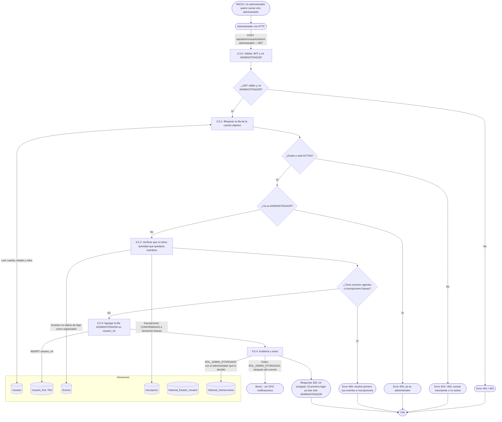

# DFD 6.5 — Otorgar y revocar el rol ADMINISTRADOR (propuesta)

**Estado:** pendiente de programar. **Es una propuesta**: ni el RF-6.2 ni los demás requisitos definen cómo se crea un administrador. Hoy la única cuenta administradora existe porque se la promovió **por SQL** (ver `docs/log/sprint_2/2026-10-14_cuenta_admin_dev.md`). Sin este flujo, el panel de administración no se puede traspasar ni ampliar.

## Contexto que condiciona el diseño

- **Un administrador es solo administrador.** `Usuario.getRoles()` colapsa los roles a `["ADMINISTRADOR"]` si la cuenta tiene ese rol: no puede inscribirse, valorar ni organizar (regla del 2026-10-15). Por lo tanto **promover una cuenta con actividad la deja sin poder usarla como participante u organizador**.
- Los roles viven en la tabla `usuario_rol` (`UsuarioRol` ↔ `Rol`); alcanza con agregar o quitar una fila, sin tocar la entidad `Usuario`.
- `AdminUsuarioService.esGestionable` ya protege a los administradores: no se pueden suspender entre sí ni a uno mismo.

## Endpoints propuestos (rol `ADMINISTRADOR`)

| Método y ruta | Qué hace | Respuestas |
|---|---|---|
| `POST /api/admin/usuarios/{id}/rol-administrador` | Otorga el rol. | 200 · 404 · 409 (no cumple las condiciones) |
| `DELETE /api/admin/usuarios/{id}/rol-administrador` | Lo revoca. | 200 · 404 · 409 (propia cuenta o último administrador) |

## Flujo

## Reglas

| Regla | Motivo |
|---|---|
| **Solo un administrador otorga el rol.** No hay auto-registro ni "pedir ser admin". | Escalada de privilegios. |
| **La cuenta objetivo tiene que estar `ACTIVA`.** | No se promueve una cuenta bloqueada, suspendida o dada de baja. |
| **Se rechaza si la cuenta tiene eventos vigentes o inscripciones futuras confirmadas.** | Como el rol colapsa los demás, esa actividad quedaría atrapada en una cuenta que ya no puede operarla. Alternativa más permisiva en [SUGERENCIAS_PENDIENTES.md](../../SUGERENCIAS_PENDIENTES.md). |
| **La revocación no puede dejar el sistema sin administradores** y no se puede revocar la propia cuenta. | Mismo razonamiento que `esGestionable`: un error del único administrador dejaría el panel inaccesible. |
| **Los JWT ya emitidos a esa cuenta** (con roles de participante/organizador) se corrigen solos: `JwtAuthenticationFilter` aplica el colapso de roles en cada pedido. | Ya implementado el 2026-10-15; no hace falta revocar tokens. |
| **Se avisa por correo al titular** (nuevo tipo `ROL_ADMIN_OTORGADO` / `ROL_ADMIN_REVOCADO`). | Si alguien comprometió una cuenta de administrador y se autopromueve a otra, el dueño legítimo se entera por el único canal que el atacante no controla. |

## Pantalla

Una acción **"Hacer administrador"** en `usuarios.html`, visible solo para cuentas `ACTIVA` sin actividad, con modal de confirmación (mismo patrón que Suspender/Reactivar: el texto lo decide el backend y el modal solo existe con la respuesta del servidor, ADR-24).
