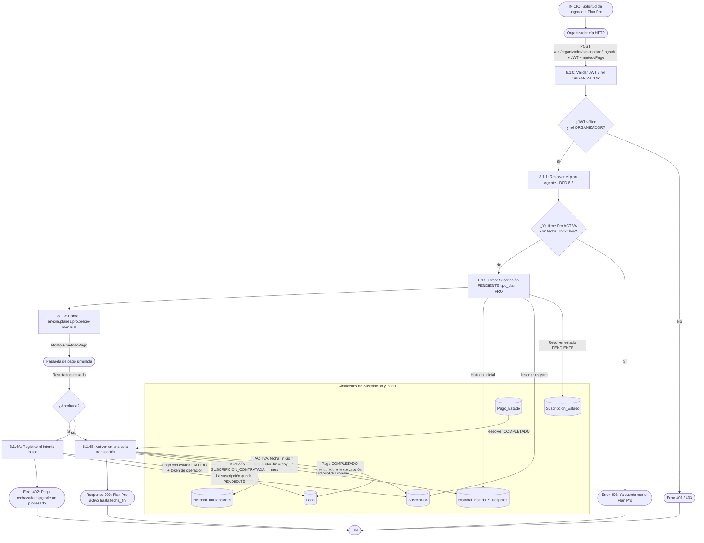
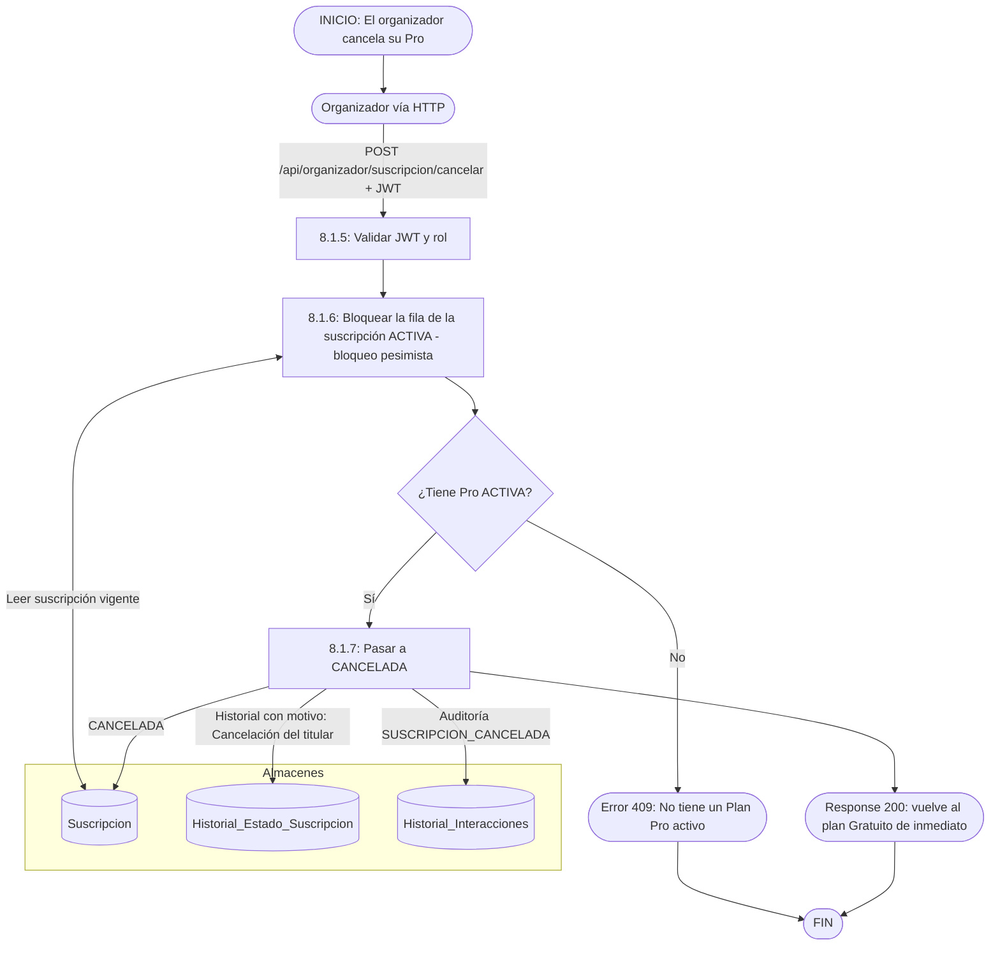
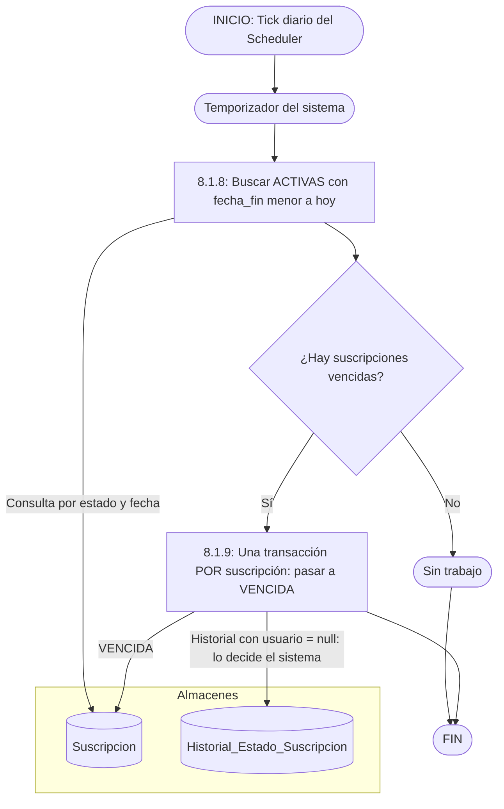

# DFD 8.1 — Ciclo de vida de la suscripción Pro (RF-8.1)

**Estado:** pendiente de programar. Reescrito el 2026-10-19: suscripción **básica** (un solo plan de pago, mensual, simulado). Incluye las tres cosas que el diseño original no cubría: **cancelar**, **vencer** y **consultar** el propio plan.

## Endpoints propuestos (rol `ORGANIZADOR`)

| Método y ruta | Qué hace | Respuestas |
|---|---|---|
| `GET /api/organizador/suscripcion` | Plan vigente, estado, `fecha_inicio`, `fecha_fin` y precio. | 200 |
| `POST /api/organizador/suscripcion/upgrade` con `{ metodoPago }` | Contrata Pro (flujo A). | 200 · 402 pago rechazado · 409 ya es Pro |
| `POST /api/organizador/suscripcion/cancelar` | Cancela el Pro vigente (flujo B). | 200 · 409 no tiene Pro activo |

Más un **job diario** (flujo C).

## Flujo A — Upgrade a Pro

## Flujo B — Cancelar

## Flujo C — Vencimiento automático (job diario)

## Reglas

| Regla | Motivo |
|---|---|
| **Una sola suscripción activa por usuario.** El 409 lo da el service y debería reforzarlo un índice (ver nota). | Dos Pro simultáneos romperían "el plan vigente es el de la última suscripción" (ADR-26). |
| **El pago rechazado también se persiste** (suscripción `PENDIENTE` + `Pago` `FALLIDO`). | El organizador ve el intento y puede reintentar. Mismo criterio que RF-3.2. |
| **`Pago.id_suscripcion` es `@OneToOne`**: una suscripción tiene, a lo sumo, un pago. Un reintento tras un rechazo usa la **misma** suscripción `PENDIENTE` y reemplaza el pago fallido, o crea otra; hay que decidirlo antes de programar. | Limitación del modelo actual (ver `Pago`). |
| **Pro mensual: `fecha_fin = hoy + 1 mes`**, sin renovación automática. Renovar = volver a contratar. | Es lo que ya asume `AdminSuscripcionService.renovarCobertura` para el plan mensual. |
| **Cancelar es inmediato** (vuelve a Gratuito en el acto). | Es la opción más simple y coherente con `REVOCAR` del panel. Alternativa en [SUGERENCIAS_PENDIENTES.md](../../SUGERENCIAS_PENDIENTES.md). |
| **El job de vencimiento usa una transacción por suscripción** y una clase aparte del `@Scheduled`. | Evita la trampa de la autoinvocación que salta el proxy transaccional (ver `FinalizacionEventosJob` y `FinalizacionEventosService`). |
| **El cambio de plan nunca toca los eventos publicados.** | No hay tope de eventos (D2): bajar a Gratuito solo cierra las estadísticas avanzadas. |

> **Para quien programe:** copiar la estructura de `RegistroInscripcionService` (la fase atómica que siempre hace *commit*, aun con pago rechazado) y la de `FinalizacionEventosJob` + `FinalizacionEventosService` (disparador separado de la lógica transaccional). Considerar un índice único parcial o un chequeo con bloqueo pesimista para garantizar "una ACTIVA por usuario" aun con dos pedidos simultáneos.
