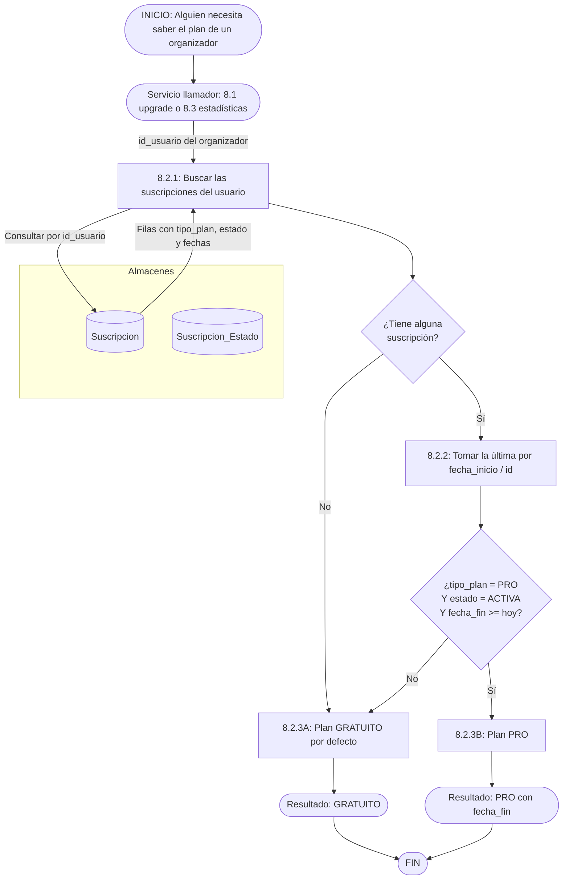

# DFD 8.2 — Resolución del plan vigente (RF-8.2, sin tope de eventos)

**Estado:** pendiente de programar (la parte de "quitar el tope" **ya se hizo** el 2026-10-19). El archivo conserva su nombre original (`control_cuotas_plan`) para no romper enlaces, pero **ya no hay cuotas**: el proceso se limita a responder *"¿este organizador es PRO o GRATUITO hoy?"*.

## Qué se eliminó del código (hecho)

| Elemento | Estado |
|---|---|
| `EventoService.verificarLimiteDePlan` (rechazaba al llegar a 20 eventos) | **Eliminado** |
| `EventoRepository.contarVigentesDeOrganizador` | **Eliminado** (quedó sin uso) |
| Propiedades `enexia.eventos.limite-plan-gratuito` y `enexia.planes.free.eventos-permitidos` | **Eliminadas** |
| Tarjeta "Plan Gratuito" del panel de suscripciones ("Límite de N eventos") | Ahora dice "Eventos ilimitados" |
| Test `limiteDePlan` | Reemplazado por `sinLimiteDePlan` (25 eventos seguidos) |

## Qué hay que programar: el servicio que resuelve el plan

Hoy el "plan vigente" se calcula solo para el panel de administración (`AdminSuscripcionService.aFila`/`esPro`). Hace falta un servicio **propio y reutilizable** que 8.1 y 8.3 consulten.



### Reglas

| Regla | Motivo |
|---|---|
| **Pro exige las tres condiciones a la vez:** `tipo_plan = PRO`, estado `ACTIVA` y `fecha_fin >= hoy`. | La fecha se chequea aunque el job de vencimiento (8.1, flujo C) no haya corrido todavía: el plan no puede quedar "Pro de más" por un día de atraso del job. |
| **Sin filas de suscripción = Gratuito.** No se crea una fila "FREE" por usuario. | Es lo que ya asume el panel de administración (ADR-26) y evita sembrar una fila por cada cuenta. |
| **Se consulta siempre la base, no un claim del JWT.** | Un token emitido antes de contratar o cancelar seguiría "diciendo" el plan viejo hasta vencer. Mismo razonamiento que ADR-20 para el estado de la cuenta. |
| **El plan se resuelve para el dueño del evento** (`Evento.organizador`), no para quien hace la consulta (D6). | Un miembro del equipo de una organización no hereda ni aporta plan. |

### Sugerencia de firma

```java
// Para programar: una clase de servicio, sin estado, con un método de lectura.
public enum PlanVigente { GRATUITO, PRO }

PlanVigente resolver(Long idUsuario);   // @Transactional(readOnly = true)
```

`AdminSuscripcionService` debería pasar a **usar** este servicio en vez de repetir la regla (`esPro`), para que el panel y el producto no puedan divergir.
