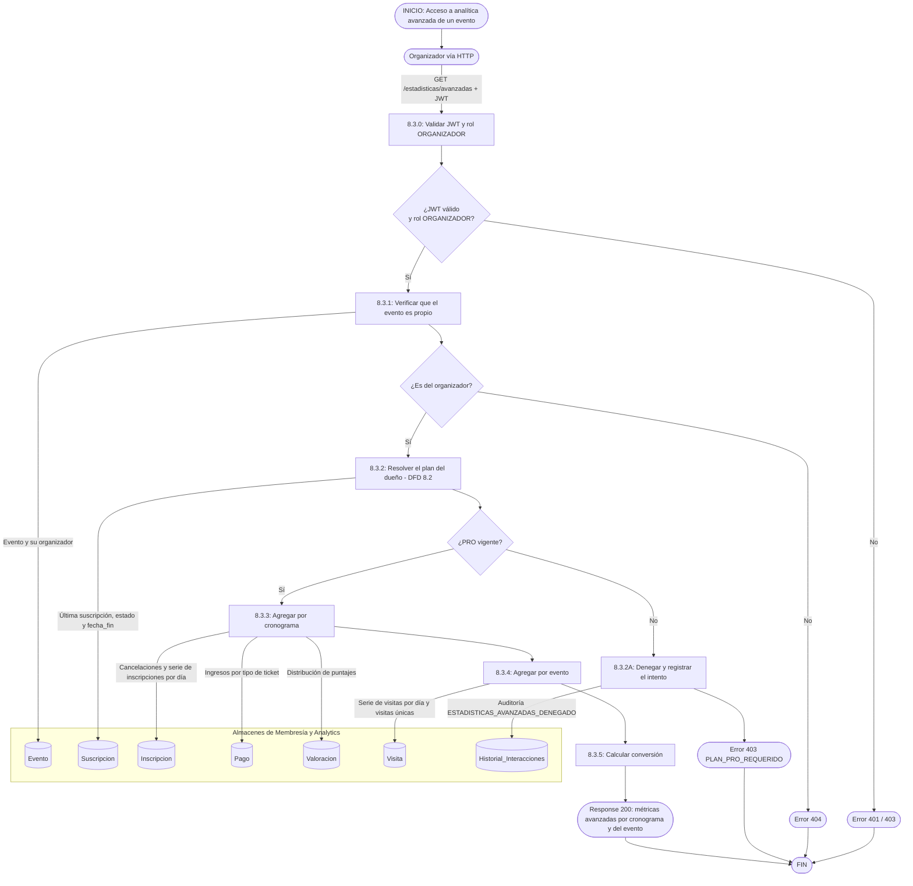

# DFD 8.3 — Estadísticas avanzadas por cronograma, solo Pro (RF-8.3)

**Estado:** pendiente de programar. Reescrito el 2026-10-19. Depende de [8.2](./8.2_control_cuotas_plan.md) (plan vigente) y [2.10](../modulo_2_estadisticas/2.10_estadisticas_por_cronograma.md) (estadísticas básicas por cronograma, que son para todos).

## Qué es "avanzado" (D5)

Las **básicas por cronograma** (cupo, inscriptos, ocupación, promedio y cantidad de valoraciones) las ve cualquier organizador. El plan **Pro** agrega, para el mismo evento:

| Métrica avanzada | Nivel | Fuente |
|---|---|---|
| **Distribución de puntajes** (cuántos 1, 2, 3, 4 y 5) | cronograma | `Valoracion.valor` agrupado |
| **Tasa de cancelación** (canceladas / inscripciones totales) | cronograma | `Inscripcion` por estado (`CANCELADA`) |
| **Ingresos** (suma de `Inscripcion.precioAbonado` de las confirmadas, menos reembolsos `REEMBOLSADO`) | cronograma y por tipo de ticket | `Inscripcion.precioAbonado` + `Pago` |
| **Serie de inscripciones por día** | cronograma | `Inscripcion.fechaInscripcion` |
| **Serie de visitas por día** (únicas y totales) | **evento** (ver D3) | `Visita.fecha_visita` |
| **Conversión** (inscriptos confirmados del evento / visitas únicas) | evento | `Visita` + `Inscripcion` |
| **Exportación de asistentes** (CSV) | cronograma | `Inscripcion` + `Usuario` |

> **Privacidad de la exportación:** solo columnas mínimas — `nickname`, tipo de ticket, fecha de inscripción y estado. **Nunca** DNI, email ni fecha de nacimiento. El organizador no necesita datos civiles para ver quién se anotó.

## Endpoints propuestos

| Método y ruta | Plan | Respuestas |
|---|---|---|
| `GET /api/organizador/eventos/{id}/estadisticas/avanzadas` | Pro | 200 · **403** si el dueño es Gratuito · 404 evento ajeno |
| `GET /api/organizador/eventos/{id}/cronogramas/{idCronograma}/asistentes.csv` | Pro | 200 `text/csv` · 403 · 404 (si el cronograma no es de ese evento) |

El **403** debe llevar un código estable (`PLAN_PRO_REQUERIDO`) para que la pantalla muestre el candado y el botón "Pasar a Pro" en vez de un error genérico.

## Flujo

## Reglas

| Regla | Motivo |
|---|---|
| **El plan se resuelve contra la base en cada pedido, nunca desde el JWT** (RF-8.3 lo permite, pero no lo recomienda). | Un token emitido antes de contratar o de cancelar mostraría el plan viejo hasta vencer (mismo razonamiento que ADR-20). |
| **Se evalúa el plan del dueño del evento** (`Evento.organizador`), no el de quien consulta. | D6. Hoy `buscarPropio` ya limita la consulta al dueño, así que ambos coinciden. |
| **Orden de las comprobaciones: autenticación → propiedad → plan.** El 404 va antes que el 403. | Un organizador Gratuito no debe poder usar el 403 para averiguar si un evento ajeno existe. |
| **Cada intento denegado se audita.** | Mide cuánta gente choca contra el candado: es el dato para decidir si el plan Pro está bien ofrecido. |
| **Los eventos no cambian cuando cambia el plan.** | D2: sin tope de eventos, bajar a Gratuito solo cierra esta pantalla. |
| **Los cronogramas no finalizados no tienen distribución de puntajes ni ingresos finales** (los muestran "en curso"). | Un puntaje o un ingreso parcial se lee como definitivo. |

## Lo que se puede reutilizar

`EventoService.buscarPropio` (propiedad con 404), `AuditoriaService.registrar`, `CronogramaTicketRepository`, `VisitaRepository` (visitas únicas/totales) y `ValoracionRepository`. **No hace falta tocar** el modelo de datos: `Inscripcion.fechaInscripcion`, `Pago.monto` y `Visita.fecha_visita` ya existen.
