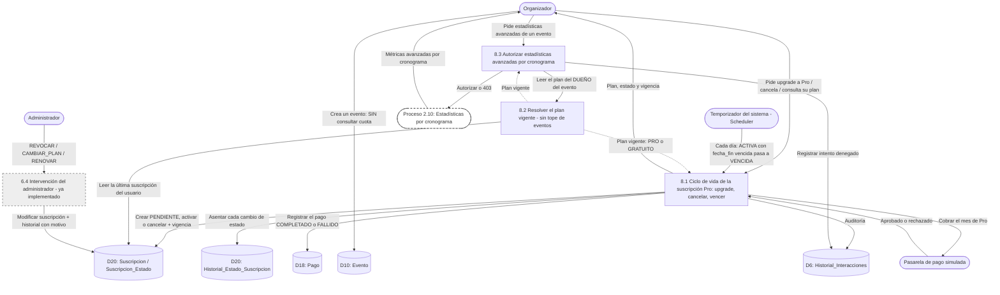

# DFD Nivel 1 — Módulo 8: Membresías (suscripción básica)

**Estado:** pendiente de programar. Reescrito el 2026-10-19 con las decisiones D1 a D6 del [README de tempDFD](../README.md): dos planes (`GRATUITO` y `PRO`), **sin límite de eventos**, y estadísticas **por cronograma**.

## Qué cambió respecto del diseño original

| Antes | Ahora |
|---|---|
| 8.2 contaba los eventos activos del organizador Free y bloqueaba la creación al llegar al límite. | **8.2 ya no bloquea nada.** Solo resuelve "¿PRO o GRATUITO?" para que 8.3 sepa si habilita lo avanzado. El flujo de creación de eventos no consulta cuotas. |
| 8.3 protegía reportes agregados por evento. | 8.3 protege las métricas **avanzadas por cronograma**; las básicas por cronograma son para todos (DFD 2.10). |
| 8.1 dejaba abierta la duración y la baja. | Pro **mensual**, sin renovación automática; el organizador puede cancelar; un job diario marca `VENCIDA`. |

## Lo que ya existe y no hay que rehacer

- Modelo: `Suscripcion`, `SuscripcionEstado` (PENDIENTE, ACTIVA, VENCIDA, CANCELADA), `HistorialEstadoSuscripcion`, `Pago` (con `id_suscripcion`).
- Panel de administración (RF-6.4): lectura de planes, ingresos del mes y las intervenciones `REVOCAR`, `CAMBIAR_PLAN`, `RENOVAR` (`AdminSuscripcionService`).
- Pasarela simulada (`PasarelaPagoSimuladaService`): un método de pago que contenga "rechazar" fuerza el rechazo.
- Configuración: `enexia.planes.pro.precio-mensual` (9.99 por defecto).

## Lo que falta (esta carpeta)

Todo el lado del **organizador** (no hay pantalla ni endpoint propio), el **vencimiento automático** (hoy nadie pasa una suscripción a `VENCIDA`: solo hay filas sembradas a mano) y las **estadísticas por cronograma**.
